# Data model (ERD)

Entity-relationship diagram of the BrainCheck database (Stage 2). Columns shown are the
keys and the fields that matter for integrity; see the migrations for the full definitions.

Conventions:

- **PK** `id` is the internal auto-increment key; **`ulid`** (UK) is the public identifier used in
  URLs and props. Numeric ids never leave the server.
- `ON DELETE` behaviour is written on each relationship label: `restrict`, `cascade` or `set null`.
- Secret columns (`questions.definition`, `attempt_questions.snapshot`, `groups.invite_code`) are
  `$hidden` on their models and read only by dedicated code paths.
- Morph columns (`*_type`) store short aliases from `Relation::enforceMorphMap()`, never class names.

```mermaid
erDiagram
    users {
        bigint id PK
        char ulid UK "Stage 3"
        string email UK
        string locale "ka | en | null"
        datetime blocked_at "null = active"
        int xp_total "cache of xp_transactions"
    }
    roles {
        bigint id PK
        string name UK "admin | teacher | student"
    }
    permissions {
        bigint id PK
        string name UK "area.action"
    }
    model_has_roles {
        bigint role_id PK,FK
        string model_type PK "morph alias: user"
        bigint model_id PK
    }
    role_has_permissions {
        bigint permission_id PK,FK
        bigint role_id PK,FK
    }
    categories {
        bigint id PK
        char ulid UK
        bigint parent_id FK "max depth 2"
        json name "{ka, en}, both required"
        string slug UK
    }
    tags {
        bigint id PK
        char ulid UK "Stage 3"
        string name UK
        string slug UK
    }
    questions {
        bigint id PK
        char ulid UK
        bigint owner_id FK
        bigint category_id FK
        string type "CHECK: 7 types"
        string difficulty "CHECK: easy | medium | hard"
        json body "rich text (Stage 4)"
        text body_text "plain text, prefix index"
        string image_path "private WebP, random name"
        json definition "SECRET (hidden)"
        decimal points "CHECK > 0"
        int version "CHECK >= 1"
        datetime deleted_at "soft delete"
    }
    question_tag {
        bigint question_id PK,FK
        bigint tag_id PK,FK
    }
    tests {
        bigint id PK
        char ulid UK
        bigint owner_id FK
        bigint category_id FK
        string status "draft | published | archived"
        smallint time_limit_minutes "CHECK 1-600"
        tinyint max_attempts "CHECK >= 1, null = unlimited"
        tinyint pass_percent "CHECK 0-100"
        string selection_mode "fixed | random_pool"
        datetime opens_at
        datetime closes_at "CHECK > opens_at"
        bool issues_certificate
        datetime locked_at "set by the first real attempt"
        datetime results_released_at "manual results released (one-way)"
        datetime deleted_at "soft delete"
    }
    test_question {
        bigint test_id PK,FK
        bigint question_id PK,FK
        smallint position "UK (test_id, position)"
        decimal points_override "CHECK > 0"
    }
    groups {
        bigint id PK
        char ulid UK
        bigint owner_id FK
        char invite_code UK "SECRET (hidden), 10 chars"
        bool joining_enabled
        datetime deleted_at "soft delete"
    }
    group_user {
        bigint group_id PK,FK
        bigint user_id PK,FK
        datetime joined_at
    }
    group_test {
        bigint group_id PK,FK
        bigint test_id PK,FK
        datetime assigned_at
    }
    teacher_access_requests {
        bigint id PK
        char ulid UK "Stage 3"
        bigint user_id FK
        string status "pending | approved | rejected"
        tinyint pending_lock "generated; UK (user_id, pending_lock)"
        bigint reviewed_by FK
        datetime reviewed_at "set iff not pending"
        text review_note "CHECK: only when reviewed"
    }
    attempts {
        bigint id PK
        char ulid UK
        bigint test_id FK
        bigint user_id FK
        bool is_preview "teacher preview, never counted"
        tinyint attempt_number "UK (test_id, user_id, attempt_number)"
        string status "in_progress | submitted | timed_out"
        string grading_status "pending_auto | pending_manual | graded"
        tinyint active_lock "generated; UK (test_id, user_id, active_lock)"
        datetime deadline_at "server-side only"
        decimal score "CHECK 0 <= score <= max_score"
        decimal score_percent "CHECK 0-100"
        char session_hash "hidden: SHA-256 of the starting session"
        datetime last_seen_at
        json event_overflow "anti-cheat counts beyond the row cap"
    }
    attempt_questions {
        bigint id PK
        bigint attempt_id FK
        bigint question_id FK "null if question removed"
        smallint position "UK (attempt_id, position)"
        json snapshot "SECRET (hidden): frozen question"
        decimal points "CHECK > 0"
    }
    attempt_answers {
        bigint id PK
        bigint attempt_question_id FK,UK "one answer per question"
        json answer
        bool flagged "come back later"
        bool is_correct
        decimal awarded_points "CHECK >= 0"
        bigint graded_by FK
    }
    test_question_stats {
        bigint id PK
        bigint test_id FK "UK (test_id, question_id)"
        bigint question_id FK
        decimal difficulty "CHECK 0-1"
        decimal discrimination "CHECK -1-1"
        json distractors
        bool needs_review
    }
    attempt_events {
        bigint id PK
        bigint attempt_id FK
        string type "anti-cheat event"
        datetime occurred_at "server time"
    }
    certificates {
        bigint id PK
        char ulid UK
        bigint attempt_id FK,UK "one per attempt"
        bigint user_id FK
        bigint test_id FK
        char verification_code UK "32 chars, CSPRNG"
        string holder_name "snapshot"
        string test_title "snapshot"
        datetime revoked_at
    }
    user_badges {
        bigint user_id PK,FK
        string badge PK "each badge once"
        datetime awarded_at
    }
    xp_transactions {
        bigint id PK
        bigint user_id FK
        int amount "CHECK <> 0"
        string reason
        string source_type "morph alias; UK (user_id, reason, source)"
        bigint source_id
    }
    audit_logs {
        bigint id PK
        bigint actor_id FK
        string action
        string subject_type "morph alias"
        bigint subject_id
        json properties
        datetime created_at "append-only"
    }
    passkeys {
        bigint id PK
        bigint user_id FK
    }

    users ||--o{ model_has_roles : "has role (exactly one)"
    roles ||--o{ model_has_roles : "cascade"
    roles ||--o{ role_has_permissions : "cascade"
    permissions ||--o{ role_has_permissions : "cascade"
    users ||--o{ passkeys : "cascade"

    categories |o--o{ categories : "parent (restrict)"
    categories |o--o{ questions : "set null"
    categories |o--o{ tests : "set null"

    users ||--o{ questions : "owns (restrict)"
    questions ||--o{ question_tag : "cascade"
    tags ||--o{ question_tag : "cascade"

    users ||--o{ tests : "owns (restrict)"
    tests ||--o{ test_question : "cascade"
    questions ||--o{ test_question : "restrict"

    users ||--o{ groups : "owns (restrict)"
    groups ||--o{ group_user : "cascade"
    users ||--o{ group_user : "member (cascade)"
    groups ||--o{ group_test : "cascade"
    tests ||--o{ group_test : "assigned (cascade)"

    users ||--o{ teacher_access_requests : "requests (cascade)"
    users |o--o{ teacher_access_requests : "reviews (set null)"

    tests ||--o{ attempts : "restrict"
    tests ||--o{ test_question_stats : "cascade"
    questions ||--o{ test_question_stats : "cascade"
    users ||--o{ attempts : "takes (restrict)"
    attempts ||--o{ attempt_questions : "cascade"
    questions |o--o{ attempt_questions : "set null"
    attempt_questions ||--|| attempt_answers : "cascade"
    users |o--o{ attempt_answers : "grades (set null)"
    attempts ||--o{ attempt_events : "cascade"

    attempts ||--o| certificates : "restrict"
    users ||--o{ certificates : "restrict"
    tests ||--o{ certificates : "restrict"

    users ||--o{ user_badges : "cascade"
    users ||--o{ xp_transactions : "cascade"
    users |o--o{ audit_logs : "actor (set null)"
```

## Tables

### Users and access control

- **users**: accounts; one role each, locale preference, blocked state, cached XP total.
- **roles / permissions / model_has_roles / role_has_permissions / model_has_permissions**: spatie
  permission tables, synced from `App\Enums\Role` / `Permission` by `braincheck:sync-permissions`.
- **passkeys**: WebAuthn credentials (laravel/passkeys).

### Content

- **categories**: two-level bilingual taxonomy for questions and tests.
- **tags**: free-form labels for questions.
- **questions**: a teacher's question bank; type-specific `definition` (secret), soft-deleted.
  `body` / `explanation` are rich text (ProseMirror JSON, allowlisted: see docs/question-types.md);
  `body_text` is the derived plain text for search and listings; `image_path` points to a
  re-encoded WebP on the private disk.
- **question_tag**: questions ↔ tags.
- **tests**: exams built from questions, with status, timing, attempt limits and availability window.
- **test_question**: the questions of a test, in order, with optional points override.

### Groups

- **groups**: a teacher's student groups, joined with a secret invite code.
- **group_user**: group membership (students).
- **group_test**: tests assigned to a group.
- **teacher_access_requests**: student requests for teacher access; one pending per user. Reviewed
  by an admin (`reviewed_by`, `reviewed_at`, optional `review_note`, which only a reviewed request can
  have). After a rejection the student waits `braincheck.teacher_request_cooldown_days`.

### Attempts (immutable history)

- **attempts**: one exam attempt; at most one in progress per user and test; server-side deadline.
- **attempt_questions**: questions frozen into an attempt (`snapshot`, secret); never read live questions.
- **attempt_answers**: the single answer row per attempt question (autosave, grading).
- **attempt_events**: anti-cheat log with server timestamps.

### Results and gamification

- **certificates**: one per passed attempt; name, title and score snapshotted at issue; revocable.
- **user_badges**: badges awarded; each badge at most once per user.
- **xp_transactions**: XP ledger; unique per user, reason and source (idempotent awards).
- **audit_logs**: append-only trail of important actions (who, what, on which subject).

### Stage 3 changes

- `users.ulid`, `tags.ulid`, `teacher_access_requests.ulid`: public identifiers for the admin pages
  (existing rows backfilled; `HasPublicUlid`).
- `teacher_access_requests.review_note` + CHECK `teacher_access_requests_note_reviewed`.

### Stage 4 changes

- `questions.body` and `questions.explanation`: TEXT → JSON rich text documents (existing text
  wrapped into paragraphs); new `questions.body_text` (plain text, index on its first 191
  characters for `LIKE 'term%'`) and `questions.image_path`.
- `numeric` definitions store decimals as strings; `ordering` definitions gain `scoring`
  (older rows are read compatibly, see docs/question-types.md).
- Attempt snapshots are history and are not migrated.
- Deleting a category sets `questions.category_id` / `tests.category_id` to NULL (unchanged FK);
  deleting or merging a tag removes / moves its `question_tag` rows (merge never creates duplicates).
- New audit keys are values of `App\Enums\AuditAction`; `audit_logs` itself is unchanged.

### Stage 5 changes

- `tests.issues_certificate` (bool, default false) and `tests.locked_at` (nullable). A test is
  locked once it has a real attempt (set by the Stage 7 exam engine); `App\Domain\Tests\TestLockRules`
  then freezes the grading-relevant settings and the question list (pivot order and overrides).
- `attempts.is_preview` (bool, default false, indexed): the teacher's "preview as student"
  attempts. They are built with the same `SnapshotBuilder` as real attempts, never lock the test,
  are excluded everywhere via `Attempt::real()` / `Test::realAttempts()` (arch test
  `tests/Arch/RealAttemptsTest.php`) and are deleted after 24 hours
  (`braincheck:prune-preview-attempts`, hourly).
- Schedule times are entered in `config('braincheck.display_timezone')` (Asia/Tbilisi) and
  stored in UTC (`App\Support\AppTime`).

### Stage 6 changes

- No schema changes. Invite codes now use `App\Domain\Groups\InviteCode` (CSPRNG, 10 characters
  from `ABCDEFGHJKMNPQRSTUVWXYZ23456789`: no 0/O/1/I/L); existing codes stay valid.
- Archiving a group is its soft delete (`groups.deleted_at`, joining also turned off); members,
  assignments and results are kept. Removing a member or unassigning a test only deletes the
  `group_user` / `group_test` row: attempts and results are untouched.
- New audit key `group.join_failed` (properties: `input_prefix`, `input_length`; never the code).

### Stage 7 changes

See `docs/exam-engine.md` for the lifecycle.

- `attempt_answers.flagged` (bool, default false): the student's "come back later" marker.
- `attempts.session_hash` (char 64, nullable, hidden): SHA-256 of the session ID that started the
  attempt; `attempts.last_seen_at` (last autosave); `attempts.event_overflow` (JSON, per-type counts
  of anti-cheat events beyond the per-attempt row cap).
- `attempt_events.type` CHECK now also allows the server-side `session_changed`.

### Stage 9 changes

See `docs/analytics.md`.

- `tests.results_released_at` (nullable): the owner released the results of a `manual` test
  (`ReleaseResults`, audited `test.results_released`; never un-released).
- New table `test_question_stats`: precomputed per-question analytics of a test's real graded
  attempts (difficulty, discrimination, average points, manual grades, distractors, review flag).
  Disposable: rebuilt by `RecomputeTestQuestionStats`; `ON DELETE CASCADE` from tests and questions;
  CHECKs on the difficulty (0…1), discrimination (−1…1) and average points (≥ 0) ranges.

### Framework tables (not shown in the diagram)

- **sessions**: database sessions (encrypted). **cache / cache_locks**: database cache and atomic locks.
- **jobs / job_batches / failed_jobs**: queue. **password_reset_tokens**: Fortify password resets.
- **migrations**: migration log. **telescope_entries / telescope_entries_tags / telescope_monitoring**:
  local-only Telescope storage.
