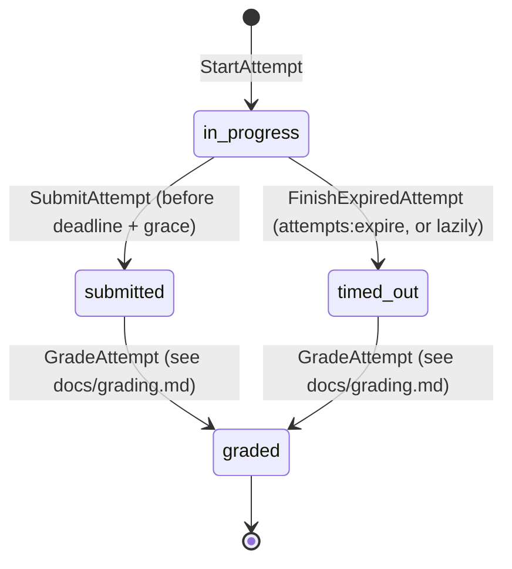

# Exam engine

How a student's exam attempt works, from start to grading. The server is the **only** authority on time, on which questions belong to an attempt, and on whether an answer is accepted.

## Lifecycle



- `status` (`in_progress`, `submitted`, `timed_out`) and `grading_status` (`pending_auto`, `pending_manual`, `graded`) are separate columns. "Graded" in the diagram means `grading_status = graded`.
- Grading (`GradeAttempt`, Stage 8) runs synchronously right after submit / expiry commits; free-text answers wait for a teacher (`pending_manual`). See `docs/grading.md`.
- Every transition is a `final` Action that runs in a transaction and re-reads the attempt with a row lock (`Attempt::lockedCopyOf()`, `SELECT … FOR UPDATE`).

### Starting (`StartAttempt`)

1. Lock the test row (`lockForUpdate`), which serialises starts per test.
2. Inside the lock, check everything again:
    - visible to the student (`AvailableTests`);
    - published;
    - `opens_at ≤ now < closes_at`;
    - real attempts used < `max_attempts`.
3. An attempt already in progress is **resumed**. If it has expired, it is finished first.
4. `SnapshotBuilder` freezes the questions:
    - random pool draw, question order and option order come from a CSPRNG (`Randomizer(new Secure)`);
    - points include overrides;
    - the student payload is stored in the snapshot, so the order is the same on every reload.
5. Create one empty `attempt_answers` row per question.
6. Store the IP, the user agent (truncated to 255 characters) and `session_hash` (SHA-256 of the session ID).
7. Set `tests.locked_at` on the first real attempt.

**Final guard:** the unique indexes `(test_id, user_id, active_lock)` and `(test_id, user_id, attempt_number)`. A unique violation from a parallel request becomes "resume the existing attempt".

## Deadline and grace

```
deadline_at = min(started_at + time_limit, closes_at)
```

- A missing part is ignored: no time limit → `closes_at`; no closing time → `started_at + time_limit`. With neither, `deadline_at = null` (the attempt never expires).
- Computed only in `StartAttempt` (`App\Domain\Attempts\AttemptTiming::deadline`). **No endpoint accepts time values from the client.**
- **Grace:** `config('braincheck.attempt_grace_seconds')`, 10 s, absorbs network latency. Autosave and submit are accepted until `deadline_at + grace`.
- After the grace period:
    - the attempt is finished as `timed_out` with `submitted_at = deadline_at`;
    - autosave and events answer **409** with `code: attempt_expired`;
    - submit redirects to the result page.
- Expiry happens in two ways:
    - `php artisan attempts:expire` runs every minute (`withoutOverlapping`, chunked, idempotent, previews skipped);
    - lazily, when the player, autosave, events or submit find an expired attempt.

**The scheduler must run in production** (`php artisan schedule:run` every minute, see Stage 15).

### Client clock

- The player computes `offset = server_now − Date.now()` at load and shows `deadline_at − (Date.now() + offset)`. A wrong device clock doesn't change the countdown.
- Warnings appear at 5 and 1 minute. At 0 the client submits.
- The server decides anyway.

## Endpoints (student area)

| Route                                                        | What                                           | Guard                              |
| ------------------------------------------------------------ | ---------------------------------------------- | ---------------------------------- |
| `GET /student/exams`                                         | List: in progress, available, upcoming, closed | `AvailableTests` only              |
| `GET /student/exams/{test}`                                  | Intro (rules, what is recorded)                | `AvailableTests` → 404             |
| `POST /student/exams/{test}/attempts`                        | Start or resume                                | `throttle:start-attempt` (10/min)  |
| `GET /student/attempts/{attempt}`                            | Player (`PlayerAttemptResource` only)          | owner, real → else 404             |
| `PUT /student/attempts/{attempt}/answers/{position}`         | Autosave → `{ saved_at }`                      | `throttle:autosave` (60/min)       |
| `POST /student/attempts/{attempt}/submit`                    | Submit (idempotent)                            | owner                              |
| `POST /student/attempts/{attempt}/events`                    | Anti-cheat batch                               | `throttle:attempt-events` (20/min) |
| `GET /student/attempts/{attempt}/questions/{position}/image` | Question image from the snapshot               | owner                              |
| `GET /student/attempts/{attempt}/result`                     | "Submitted" page (Stage 9: results)            | owner                              |

- Someone else's attempt is always a **404**, never a 403, so the response doesn't confirm that it exists.
- **Autosave** validates the answer with the type's `answerRules()` against the **snapshot** definition (IDs must exist in the snapshot) and stores only the type's keys. Fields like `deadline_at`, `score` and `status` are ignored.
- **The player never receives** the snapshot, the definition, the explanation or question IDs (leak tests in `tests/Feature/Exams/PlayerTest.php`).

## Anti-cheat data collected

Integrity events are **information for the teacher (Stage 9), never a score change**. The intro page tells the student what is recorded.

| Type              | When                                                                                                               | `meta`                                                          |
| ----------------- | ------------------------------------------------------------------------------------------------------------------ | --------------------------------------------------------------- |
| `tab_hidden`      | the page becomes hidden (`visibilitychange`)                                                                       | `question`                                                      |
| `window_blur`     | the window loses focus                                                                                             | `question`                                                      |
| `copy` / `paste`  | copy or paste on the page                                                                                          | `question`; paste also `chars` (length only, never the content) |
| `fullscreen_exit` | leaves fullscreen, only if the student opted in on the intro page                                                  | `question`                                                      |
| `session_changed` | **server-side**: an autosave from a different session than the one that started the attempt (once per new session) | `session` (first 16 hex characters of the session hash)         |

**Limits:**

- The client sends batches every 10 s and right before submit; at most 50 events per request (`braincheck.attempt_events_per_request`).
- At most 500 stored rows per attempt (`braincheck.attempt_events_per_attempt`). Beyond that, only a per-type counter grows (`attempts.event_overflow`).
- `meta` accepts only the integer keys `question`, `duration_ms` and `chars`, up to 1 KB.
- The event time is always the server's.

**A different session never blocks the student:** re-logging in is legitimate. The answer is saved and the event is recorded for the teacher.

**A second tab** of the same attempt (`BroadcastChannel`) shows a warning in the newer tab; the server keeps the last save.

## Removing members and unassigning tests

The visibility rule (`AvailableTests`) decides who can **start** an attempt. An attempt already in progress belongs to its owner (`AttemptPolicy::take`): a removed member, a student who left, or a student whose test was unassigned can still finish it until the deadline. Past results stay.
