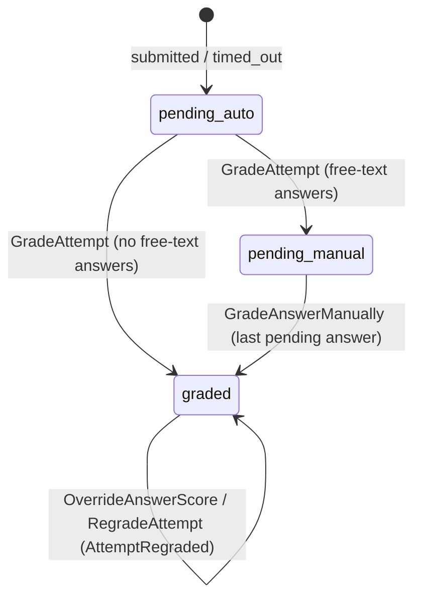

# Grading

How attempts are graded, manually graded, overridden and regraded. All arithmetic uses `App\Domain\Questions\Points` (brick/math, scale 2, half-up). **No floats.** Grading reads only the attempt's **snapshots**, never the live questions.

## Status transitions

- `GradeAttempt` grades only `pending_auto` attempts, which makes it idempotent. Changes afterwards go through `GradeAnswerManually`, `OverrideAnswerScore` or `RegradeTestQuestion` → `RegradeAttempt`.
- It runs **synchronously** right after submit or expiry commits: attempts are small (≤ 200 questions, pure computation). If it ever becomes heavy, wrap it in a queued job that implements `ShouldBeUnique` per attempt.
- **`AttemptGraded`** fires once, after commit, when an attempt first becomes `graded`. Consumers: certificates (Stage 10), XP (Stage 11).
- **`AttemptRegraded`** (old/new score and `passed`) fires after commit when an override or a regrade changes the score or the pass result.

## Formulas

**Per answer:** `handler->grade(snapshotDefinition, answer, points)`, where `points` are the snapshot points (test override applied).

| Type                              | Full                                | Partial                                       | Zero                  |
| --------------------------------- | ----------------------------------- | --------------------------------------------- | --------------------- |
| Single choice                     | the correct option                  | —                                             | anything else / empty |
| Multiple choice, `all_or_nothing` | exactly the correct set             | —                                             | anything else         |
| Multiple choice, `partial`        | exactly the correct set             | `points × (right − wrong) / correct`, floor 0 | —                     |
| True / false                      | the correct value                   | —                                             | anything else / empty |
| Numeric                           | `abs(answer − correct) ≤ tolerance` | —                                             | otherwise / empty     |
| Ordering, `all_or_nothing`        | every item in place                 | —                                             | otherwise             |
| Ordering, `partial`               | every item in place                 | `points × in_place / items`                   | —                     |
| Matching                          | every pair right                    | `points × right_pairs / pairs`                | —                     |
| Text                              | — (the teacher grades)              |                                               |                       |

**Fractions:** `Points::timesFraction` computes the exact rational value, then rounds once to 2 decimals, half-up. Examples: ⅓ of 1.00 = 0.33; ⅔ of 1.00 = 0.67; ⅓ of 2.00 = 0.67.

**Correctness:** `is_correct` is `true` for full points and `false` for zero. Partial credit gives `false` from the handlers, but `null` from teacher grades and overrides.

**Totals** (`App\Domain\Grading\AttemptTotals`):

- `max_score = Σ snapshot points`
- `score = Σ awarded_points` (ungraded answers count 0)
- `score_percent = score / max_score × 100`, scale 2, half-up (0 when `max_score` is 0)
- `passed = score_percent ≥ pass_percent` (**equality passes**; 0.01 below fails). While any answer waits for manual grading, `passed` is `null` and the score is provisional (`pending_manual`).

**Invariant** (property test): `score == Σ awarded_points` and `0 ≤ score ≤ max_score`.

## Manual grading

`/teacher/grading` lists the free-text answers of the teacher's own tests, oldest submission first, filterable by test and group, with counts per test.

**Grading screen:**

- question and reference answer from the snapshot;
- the student's text as a **plain string** (rendered as text with line breaks, never HTML);
- points from 0 to the maximum in steps of 0.25 (the maximum itself is always allowed) and feedback (≤ 2000 characters);
- "Save & next" with Ctrl/⌘ + Enter.

**Anonymous mode** (default; kept in the session):

- shows "Student #N", numbered per test by first attempt;
- revealing one student is audited as `grading.identity_revealed` with `scope: attempt`;
- switching anonymity off is audited with `scope: all`.

**Concurrency:** every grade sends the grading version it loaded (a hash of points, grader, time and feedback). If someone else graded meanwhile, the second save is refused with a conflict message.

## Overrides

The test owner can change an **auto-graded** answer's points with a **mandatory reason**. Totals are recomputed and the change is audited as `grading.override` (position, old and new points, reason). Free-text answers are changed through manual grading instead.

## Regrade policy

When a question's correct answer was wrong:

**Who:** the test owner (teacher area) or an admin (`attempts.regrade-any`, admin area).

**Steps:**

1. Pick the question version used by the test's attempts.
2. Mark the right answer.
3. Preview the score and pass changes.
4. Confirm with a **fresh password** (`password.confirm`).

**Scope:** one test, one question, one snapshot version, real attempts only. Other tests that use the same question, and the question bank itself, are untouched.

**Only correctness may change:** the type and the option / item IDs must stay exactly what students saw. The snapshot's player payload is never touched.

**Execution:**

- Audited at start as `grading.regrade` with a summary (affected attempts, changed scores, pass flips).
- Then queued (`RegradeTestQuestionJob`, chunks of 50, unique per test question version).
- Each finished attempt gets `RegradeAttempt` for that question: the new auto result replaces earlier ones (overrides on that question included), while teacher grades of free-text answers stay. `AttemptRegraded` fires when the score or pass result changes.
- Attempts still in progress just get the fixed definition and are graded with it on submit.

**Snapshots:** `RegradeTestQuestion::applyTo()` is the **only** code path that modifies `attempt_questions.snapshot` (`tests/Arch/SnapshotImmutabilityTest.php`).
